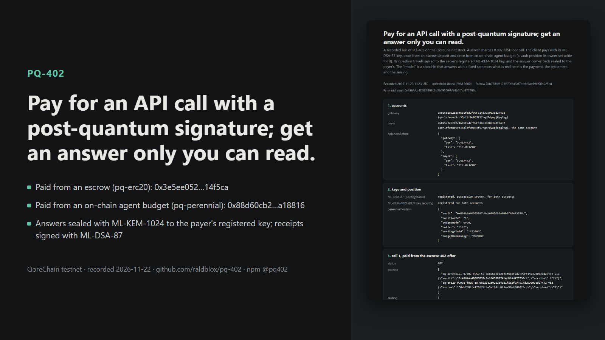

# PQ-402



**Pay for an API call with a post-quantum signature; get an answer only you
can read.**

**The problem.** An API provider who wants to charge per request needs
accounts, API keys and billing, and an agent cannot sign up for any of them.
Pay-per-request protocols such as [x402](https://github.com/x402-foundation/x402)
remove the accounts, but the payment is still authorised with an ECDSA
signature that a quantum computer could forge, and the request and the answer
can be read by anyone on the path beyond TLS, or recorded today and read later.

**What PQ-402 does.** A server answers `402 Payment Required` with a price.
The client pays with a signature from its **ML-DSA-87** key, which the
contract that moves the money checks on the QoreChain testnet. The request
travels encrypted with **ML-KEM-1024** to the server's registered key, and the
answer comes back encrypted to the client's registered key, so only the payer
can read it. Each answer carries a receipt signed by the server's ML-DSA-87
key. The wire format stays x402 v2.

**Live demo:** [pq-402.vercel.app](https://pq-402.vercel.app), a recorded run
on the testnet, step by step, with its transaction hashes.

## What it does

A client calls an API. The server answers `402` with a price. The client signs
a payment with its ML-DSA-87 key, seals its request body to the server's
ML-KEM-1024 key, and retries. The server checks the payment, opens the
request, runs the handler, seals the answer to the client's ML-KEM-1024 key,
settles the payment on chain and returns the sealed answer with a signed
receipt. The client checks the receipt and opens the answer.

The client pays one of two ways ([decision 007](docs/decisions/007-two-schemes.md)):

| Scheme | Paid from | Settled by |
|---|---|---|
| `pq-erc20` | a deposit of fUSD in [`PQ402Escrow`](contracts/src/PQ402Escrow.sol), a small escrow contract | `PQ402Escrow.settle`, which checks the ML-DSA-87 signature with the `pqcVerify` precompile |
| `pq-perennial` | an on-chain agent budget: a vault position whose owner set aside funds the agent may spend (see [Works with](#works-with)) | the vault's own `spend`, which checks the agent's ML-DSA-87 signature |

The client holds no QOR and sends no transaction: the server's facilitator
submits the settlement and pays the gas ([decision 008](docs/decisions/008-relayer-pays-gas.md)).

## Why post-quantum

- **The payment** is authorised by ML-DSA-87 (FIPS 204), verified on chain
  against the key the payer registered with QoreChain, by the contract that
  moves the money. The classical key alone cannot pay.
- **The request and the answer** are sealed with ML-KEM-1024 (FIPS 203)
  through [QoreSeal](https://www.npmjs.com/package/@qorechain/qoreseal), to keys
  read from the chain's KEM key registry, never from the other side's headers.
- **The receipt** for each answer is signed with the server's ML-DSA-87 key
  and binds the payment, the request and the exact bytes of the answer.

What it does not protect is listed in [docs/threat-model.md](docs/threat-model.md):
among others, metadata (paths, sizes, amounts) stays visible, and the
QoreChain PQC precompiles and KEM registry are testnet features today.

## How it works

```
client                                                     server
  │ POST /v1/chat/completions  (no body; PQ402-Probe: 1)     │
  │ ───────────────────────────────────────────────────────▶ │
  │ 402  PAYMENT-REQUIRED: pq-perennial, pq-erc20;           │
  │      pq402-sealing: gateway 0x…                          │
  │ ◀─────────────────────────────────────────────────────── │
  │ read the gateway's ML-KEM-1024 key from the chain        │
  │ seal the body; sign a payment bound to                   │
  │ hash(method, path, sealed body) with ML-DSA-87           │
  │ POST  PAYMENT-SIGNATURE: …   body: sealed envelope       │
  │ ───────────────────────────────────────────────────────▶ │ check request hash and replay
  │                                                          │ verify: key via pqcKeyStatus,
  │                                                          │   signature, nonce, funds
  │                                                          │ open the request, run the handler
  │                                                          │ seal the answer to the payer's key
  │                                                          │ settle on chain (relayer pays gas)
  │ 200  PAYMENT-RESPONSE: tx + signed receipt               │ sign the receipt
  │      body: sealed answer                                 │
  │ ◀─────────────────────────────────────────────────────── │
  │ check the receipt against the gateway's key; open        │
```

Headers and JSON objects are standard x402 v2, so a stock x402 client reads
the `402` and skips the schemes it cannot pay. The normative description is
[docs/spec.md](docs/spec.md); the reasoning is in [docs/decisions/](docs/decisions/).

## Post-quantum encryption, in detail

Each point below names the code that does it, the test that shows it, and the
testnet transaction where it happened.

**1. ML-KEM-1024 encryption.** Bodies are sealed with QoreSeal envelopes in
ML-KEM-1024 mode (`mode: "mlkem"`): `sealRequest`, `openRequest`,
`sealResponse` and `openResponse` in
[packages/core/src/sealing.ts](packages/core/src/sealing.ts) call QoreSeal's
`seal` and `open` and nothing else; there is no cryptography of our own. The
request is sealed for the purpose `pq402-request`, bound to the method, path
and content type; the answer for `pq402-response`, bound to the request hash
and content type. Tests:
[packages/core/test/sealing.test.ts](packages/core/test/sealing.test.ts)
(a wrong key, path, method, type or chain cannot open; a flipped byte is
rejected) and a known-answer envelope in
[packages/core/test/vectors/v1.json](packages/core/test/vectors/v1.json).
On the testnet, calls 1 and 2 of the [recorded run](https://pq-402.vercel.app)
sent 1,807-byte envelopes and got 1,799-byte envelopes back; they settled in
`0x3e5ee052…b14f5ca` and `0x88d60cb2…da18816`.

**2. Registered recipient keys.** Neither side takes a key from the other's
messages. The `402` names the gateway's address; the client reads the
gateway's ML-KEM-1024 key from the chain's KEM key registry, and the server
reads the payer's the same way, through `EvmChainReader.kemKey` in
[packages/scheme-qorechain/src/evm.ts](packages/scheme-qorechain/src/evm.ts)
(QoreSeal's `fetchMlkemPublicKey`, REST `/qorechain/pqc/v1/kem/{address}`). The
server reads the payer's key before running the handler and refuses a payer
without one. The account in the recorded runs registered its key with
`MsgRegisterKEMKey` in `D4E53C1B0164FC76656D07CB76611134E7EE0C8300CC6110961EAAB096DAD5EC`
(algorithm 2, a 1,568-byte ML-KEM-1024 key). Tests in
[packages/client/test/roundtrip.test.ts](packages/client/test/roundtrip.test.ts):
"cannot open a request sealed to a key that is not the gateway's" and
"refuses a payer with no registered KEM key, without running the handler".

**3. Binding to the ML-DSA-87 identity.** The encryption key and the signing
key belong to the same QoreChain account, and both are read by that account's
address:

- The KEM key was registered in a hybrid-signed transaction: the
  `MsgRegisterKEMKey` above carries a `PQCHybridSignature` extension with a
  4,627-byte ML-DSA-87 signature alongside the account's classical one.
  QoreChain asks for that signature on native transactions other than the
  ML-DSA key registration itself
  ([post-quantum signing](https://docs.qorechain.io/developer-guide/post-quantum-signing)).
- A payment is accepted only when its ML-DSA-87 signature verifies against the
  key `pqcKeyStatus` reports for the payer's address, registered with proof of
  possession: in the facilitator
  ([facilitator.ts](packages/scheme-qorechain/src/facilitator.ts),
  [perennial.ts](packages/scheme-qorechain/src/perennial.ts)) and again on
  chain ([PQCAuth.sol](contracts/src/libraries/PQCAuth.sol)).
- Only then does the server seal the answer, to the KEM key registered for that
  same address. A stolen classical key alone cannot sign a payment.
- In the other direction, the receipt is signed by the gateway's ML-DSA-87 key,
  and the client checks it against `pqcKeyStatus` for the gateway's address,
  the account whose KEM key sealed the request (test: "rejects a receipt not
  signed by the gateway's registered key").

**4. Client-side encryption and decryption.** The client seals before anything
leaves its process and opens after the answer arrives, in
[packages/client/src/fetch.ts](packages/client/src/fetch.ts) (`sealRequest`
after reading the gateway's key; `openResponse` after checking the receipt).
A sealing client first sends a body-less probe, so the plaintext is never sent,
not even to learn the price. Test: "seals the request body: the plaintext never
crosses the wire". The recorded testnet run checks the same: its transcript
records `plaintext visible on the wire: false` for both calls.

## Install

```bash
npm install @pq402/client @pq402/scheme-qorechain   # the paying side
npm install @pq402/server @pq402/scheme-qorechain   # the serving side
```

| Package | npm | What it holds |
|---|---|---|
| [`packages/core`](packages/core) | [`@pq402/core`](https://www.npmjs.com/package/@pq402/core) | message encoding, ML-DSA-87 signing, ML-KEM-1024 sealing (QoreSeal), receipts; no network |
| [`packages/scheme-qorechain`](packages/scheme-qorechain) | [`@pq402/scheme-qorechain`](https://www.npmjs.com/package/@pq402/scheme-qorechain) | the x402 client, server and facilitator plugins for both schemes; chain adapters |
| [`packages/server`](packages/server) | [`@pq402/server`](https://www.npmjs.com/package/@pq402/server) | the payment gate and a `node:http` adapter |
| [`packages/client`](packages/client) | [`@pq402/client`](https://www.npmjs.com/package/@pq402/client) | the paying `fetch` |
| [`contracts`](contracts) | – | `PQ402Escrow` (Foundry) |

```ts
import { createPq402Fetch } from "@pq402/client";
import { EvmChainReader, qorechainTestnet } from "@pq402/scheme-qorechain";

const pay = createPq402Fetch({
  payer, mldsaSecretKey, sealKeys,       // the client's account and keys
  keys: new EvmChainReader({ network: qorechainTestnet }),
  chainId: "qorechain-diana",
  maxAmount: 5_000n,                     // never more than 0.005 fUSD a call
});
const res = await pay("https://api.example/v1/chat/completions", { method: "POST", body });
```

The server side is in [examples/server.ts](examples/server.ts).

## Quickstart

Node 22 or later, pnpm 10, and [Foundry](https://getfoundry.sh) for the
contracts. Runs locally against an in-memory model of the chain with real
ML-DSA-87 and ML-KEM-1024; nothing to fund.

```bash
git clone --recurse-submodules https://github.com/raldblox/pq-402.git
cd pq-402
pnpm install
pnpm build
pnpm test                 # TypeScript tests
pnpm contracts:test       # Solidity: unit, fuzz, invariant, vectors

# terminal 1: a paid endpoint
pnpm example:server
# terminal 2: pays three calls from an agent-budget position and two
# from an escrow, and opens every sealed answer
pnpm example:client
```

The same flow on the testnet is `pnpm demo`; see
[docs/quickstart.md](docs/quickstart.md). The answers come from a stand-in
model that only reports how many characters it received.

## Status

What has been run, and where. "In memory" is the TypeScript model of the
chain; "stand-in" is the Solidity mock of the PQC precompiles, which models
their interface, not their cryptography.

| Part | Tested | On the testnet |
|---|---|---|
| Signed bytes, ML-DSA-87, ML-KEM-1024 sealing | 109 TypeScript tests, known-answer vectors cross-checked in Solidity | the client's signature verified by the real `pqcVerify` (`eth_call`), refused with one bit flipped |
| `PQ402Escrow` | 43 Foundry tests: unit, fuzz (512 runs), invariant (8,192 calls), vectors | deployed; deposits, settlements, a signed withdrawal and payouts (below) |
| `pq-erc20` end to end | over real HTTP against the in-memory chain | three paid, sealed calls settled (below) |
| `pq-perennial` end to end | over real HTTP against an in-memory model of `spend`, budget mode included; relayer gas estimated per call | one paid, sealed call settled from an agent-budget position (below); signing bytes match all three deployed vaults; a spend that has to draw on the vault's principal has not been run since the gas fix |
| Header sizes | `PAYMENT-SIGNATURE` 9,396 B, `PAYMENT-RESPONSE` 9,052 B, under Node's default 16 KiB | – |
| Proxies, CDNs, browsers | not tested; nginx's default 8 KB header line is too small ([decision 005](docs/decisions/005-header-size.md)) | – |

## Deployment and recorded runs

QoreChain testnet `qorechain-diana`, EVM chain id 9800. The explorer has no
source verification: the build settings are in
[contracts/foundry.toml](contracts/foundry.toml) (solc 0.8.28, optimizer on,
200 runs); the runtime code is 6,283 bytes, as `forge build --sizes` reports.

| | |
|---|---|
| `PQ402Escrow` | [`0xb7384fe171670fba5af74fc8f5aa99ef084025cd`](https://explore.qore.network/address/0xb7384fe171670fba5af74fc8f5aa99ef084025cd), deployed in [`0xd8ce83c6…14cd8b`](https://explore.qore.network/tx/0xd8ce83c612f9b2371211ff0c4cc1ad5caf2e3a37ad08309796315efb4d14cd8b); withdrawal delay 120 s for this test deployment (the deploy script's default is 3,600 s) |
| Agent-budget vault ([Perennial](#works-with), accelerated test rate) | `0x496AAa4D585B97c8a26095D97Af4bBfAd473798c`, position 1 |
| Asset | fUSD `0x97143B771D34ddb9130b807b135Ae675A5a963CA` |
| Account | `0x825c2e0282c4681fad2f99F514d3D3003cd27432` / `qor1sfwzuq5zc35pltf0n863f57nqq7dyapj6gqlyg`: deployer, gateway, relayer and payer at once, so every payment returned to it |

**22 November 2026, `pnpm demo`** (the run on the [demo page](https://pq-402.vercel.app); transcript in [site/run.json](site/run.json)):

| Step | Transaction | Gas |
|---|---|---|
| open an EVM window scoped to the escrow, the vault and fUSD | `27F9B3E0A54645BF8B874537E53D7B1F61E539152BC2E6A9B5C6206509E9215A` | native |
| approve exactly 0.01 fUSD | [`0x2700f66c…06fdb7f`](https://explore.qore.network/tx/0x2700f66c2a361bdc6d9633817fdc7e08fa88a43fdea2d36cd3f6c8f5c06fdb7f) | |
| deposit 0.01 fUSD into the escrow | [`0x0e5b96d5…9986c66`](https://explore.qore.network/tx/0x0e5b96d5a7d8052c4363fc629721a26c02cdc9fa841d60c8d8d2445dfc7eaa04) | |
| call 1, sealed, paid with `pq-erc20`: `Settled` | [`0x3e5ee052…b14f5ca`](https://explore.qore.network/tx/0x3e5ee052f9cde5df06eb3511d398d9f63051e4cb9396faaf552ff91e8b14f5ca) | 253,160 |
| call 2, sealed, paid with `pq-perennial`: `Spent` from position 1 | [`0x88d60cb2…da18816`](https://explore.qore.network/tx/0x88d60cb2df8a36d19e14ab2eae05ce8067938a59565cdbc7d2032eeb3da18816) | 324,172 |
| request withdrawal of 0.008 fUSD (ML-DSA-87 signed) | [`0x58394d52…7a9f8`](https://explore.qore.network/tx/0x58394d52187cb73fd9b8957888b2f66340ed32574c8d4950ed27b28ed1d7a9f8) | |
| withdraw 0.008 fUSD: `Withdrawn` | [`0x19265cac…de7ec7`](https://explore.qore.network/tx/0x19265cac5fe81826a0f1c9087ecc095264583830240206de0062e75f28de7ec7) | 65,000 |
| close the EVM window | `4527A875BCB6A98CBED589F3DE2078D1C7BC38BD58658F66CFACF5C3A373B447` | native |

**16 November 2026** (first run, `pq-erc20` only):

| Step | Transaction | Gas |
|---|---|---|
| ML-KEM-1024 key registered (`MsgRegisterKEMKey`) | `D4E53C1B0164FC76656D07CB76611134E7EE0C8300CC6110961EAAB096DAD5EC` | native |
| deploy `PQ402Escrow` | `0xd8ce83c612f9b2371211ff0c4cc1ad5caf2e3a37ad08309796315efb4d14cd8b` | 1,479,436 |
| approve 0.05 fUSD (exact) | `0x2821cc46cff914621d722d05171be420e6f143c8cb087e985d55e2a692b44c9e` | 46,318 |
| deposit 0.05 fUSD | `0xc43b4e3ffe7fd7265f4aee05d348a05aa41af0b8f3a6f407e61dc80d49986c66` | 83,910 |
| sealed response, `settle` | `0xdfb1d269156caf98528120a59ba4ede7b7b4ef32c759652437d41a2dd66c4e0a` | 253,160 |
| sealed request and response, `settle` | `0xb7f9fd66e96619492f8d2dc439d91a73fc6313dab11bbca04af3d1656c7c6a02` | 253,388 |
| `requestWithdrawal` (ML-DSA-87 signed) | `0x97948aa83c180ee208411bab9ab5a629850160417c12469f9cc711ce2f8f2647` | 271,183 |
| `withdraw` 0.03 fUSD | `0x3e92bc071ebeddd7776406e3e9f3a906a90ece1bec95de7211b8479a665b4707` | 65,000 |

Every EVM transaction ran inside an EVM window scoped to the contracts it
called, closed afterwards; the deployment used a one-transaction window,
because a scoped window refuses contract creation. Setting up a testnet run
from scratch is described in [docs/quickstart.md](docs/quickstart.md).

## Works with

PQ-402 stands on its own: the escrow scheme needs nothing else. Two other
projects use it:

- **On-chain agent budgets.** [Perennial](https://github.com/raldblox/perennial)
  is a vault where an owner sets money aside for an agent, which may spend only
  what the vault allows. With `pq-perennial`, the agent pays for API calls
  straight from that budget, signing the vault's `spend` with its ML-DSA-87
  key. The recorded run used position 1 on its accelerated test vault.
- **Paid inference.** [Overwinter](https://github.com/raldblox/overwinter)
  (in development) is an inference service meant to charge through PQ-402.

## Documents

[Specification](docs/spec.md) · [Threat model](docs/threat-model.md) ·
[Decisions](docs/decisions/) · [QoreChain notes](docs/qorechain-notes.md) ·
[x402 notes](docs/x402-notes.md) · [Quickstart](docs/quickstart.md) ·
[Changelog](CHANGELOG.md) · [How AI was used](AI_USAGE.md)

## Credits

- [x402](https://github.com/x402-foundation/x402) (Apache-2.0): the protocol
  this extends, and `@x402/core`, whose types, header codecs and plugin
  interfaces PQ-402 uses unchanged.
- QoreChain kits (Apache-2.0): `@qorechain/pqc` (ML-DSA-87),
  `@qorechain/qoreseal` (ML-KEM-1024 envelopes, KEM key registry),
  `@qorechain/sdk` and `@qorechain/evm` (accounts, key registration, EVM
  windows).
- [viem](https://viem.sh) (MIT), [OpenZeppelin Contracts](https://github.com/OpenZeppelin/openzeppelin-contracts)
  and [forge-std](https://github.com/foundry-rs/forge-std) (MIT).

## License

[MIT](LICENSE)
